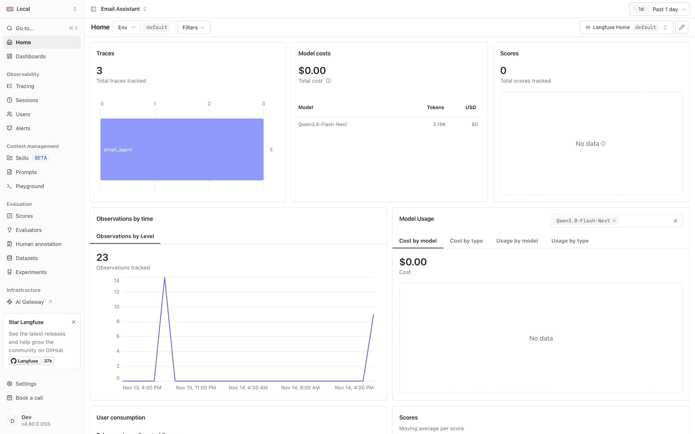
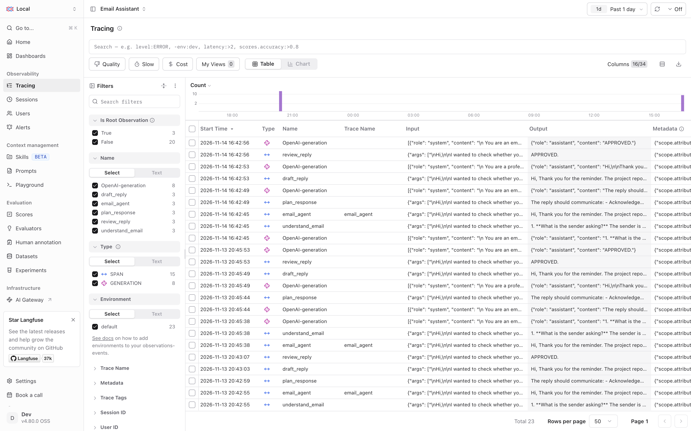
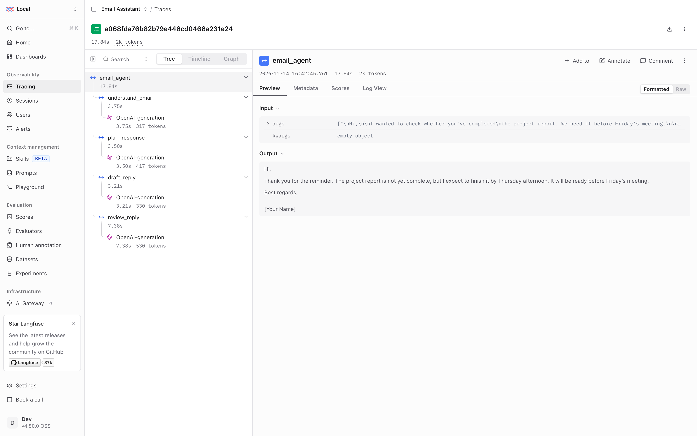

# Email Assistant

An LLM-powered email assistant that drafts polished replies to incoming emails. Instead of asking a model to "write a reply" in one shot, it runs a **multi-step agent pipeline** — understanding the email, planning the response, drafting, self-reviewing for accuracy, and revising when needed.

Model, endpoint, and credentials are configured entirely through a `.env` file (works with any OpenAI-compatible API).

## Design

```
email-assistant/
├── .env                    # endpoint, api key, model + Langfuse keys (never committed)
├── main.py                 # entry point — runs the pipeline on a sample email
├── screenshots/            # Langfuse dashboard & tracing screenshots
└── assistant/
    ├── __init__.py         # public exports
    ├── config.py           # loads .env, exposes BASE_URL / API_KEY / MODEL
    ├── llm_client.py       # builds the OpenAI-compatible client (Langfuse-instrumented)
    ├── prompts.py          # all system prompts + user-prompt templates
    └── agent.py            # the pipeline: understand → plan → draft → review → revise
```

### Separation of concerns

| Module | Responsibility |
|---|---|
| `config.py` | Loads `.env` once; single source of truth for `MODEL`, `BASE_URL`, `API_KEY` |
| `llm_client.py` | Only place that touches the OpenAI SDK |
| `prompts.py` | Every prompt in one file — tune behavior without touching logic |
| `agent.py` | Pipeline steps + the `email_agent()` orchestrator |
| `main.py` | Demo / entry point |

### Pipeline

```
Incoming email + user context
        │
        ▼
┌─────────────────────┐
│ 1. understand_email │  What is being asked? Is a reply required?
└─────────┬───────────┘  What must the reply include?
          ▼
┌─────────────────────┐
│   2. plan_response  │  What should the reply communicate,
└─────────┬───────────┘  using ONLY the user-provided facts?
          ▼
┌─────────────────────┐
│    3. draft_reply   │  Polite, clear, concise reply
└─────────┬───────────┘
          ▼
┌─────────────────────┐      starts with "NEEDS_REVISION"?
│    4. review_reply  │ ─────────────────────────────┐
└─────────┬───────────┘                              │
          │ APPROVED                                 ▼
          │                              ┌──────────────────┐
          │                              │  5. revise_reply │
          │                              └────────┬─────────┘
          ◄───────────────────────────────────────┘
          ▼
     Final email
```

### Why multiple steps?

Each step has a focused system prompt with guardrails, which is far more reliable than a single mega-prompt:

- **Understand** analyzes before generating — it never drafts ("Do not draft the reply yet").
- **Plan** locks the reply to user-provided facts ("Never invent facts or commitments"), so the model can't hallucinate a delivery date.
- **Draft** only writes what the plan approved.
- **Review** acts as a separate critic checking: does it answer the request, is it professional, does it contain **unsupported information**? It must answer `APPROVED` or `NEEDS_REVISION`.
- **Revise** runs *only if* the reviewer rejects the draft, preserving all facts.

## Functioning

### Setup

```bash
python3 -m venv .venv
.venv/bin/pip install openai python-dotenv langfuse

# configure the model (any OpenAI-compatible endpoint works) + Langfuse keys
cat > .env <<'EOF'
OPENAI_BASE_URL=http://your-endpoint:8888/v1
OPENAI_API_KEY=***
MODEL=Qwen3.8-Flash-Next

# Langfuse (paste the keys from your Langfuse project settings)
LANGFUSE_HOST=http://localhost:3000
LANGFUSE_PUBLIC_KEY=pk-lf-...
LANGFUSE_SECRET_KEY=sk-lf-...
EOF
```

### Run

```bash
.venv/bin/python main.py
```

### Use as a library

```python
from assistant import email_agent

final_email = email_agent(
    email="Can we reschedule Monday's review to Wednesday?",
    user_context="Wednesday before 2pm works. Monday is not possible.",
)
print(final_email)
```

Individual steps are exported too (`understand_email`, `plan_response`, `draft_reply`, `review_reply`, `revise_reply`) if you want to inspect or intervene between stages.

## Observability with Langfuse

Every pipeline run is traced to [Langfuse](https://langfuse.com), so you can inspect each step's inputs, outputs, latency and token usage. The integration is intentionally small:

| Where | What it does |
|---|---|
| `assistant/llm_client.py` | Imports `OpenAI` from `langfuse.openai` instead of `openai` — a drop-in client that automatically logs every LLM call as a generation (prompt, completion, tokens, cost) |
| `assistant/agent.py` | `@observe()` on each pipeline step + `email_agent()` — creates a nested span per stage, so the trace tree mirrors the pipeline |
| `main.py` | `get_client().flush()` at the end — pushes buffered events to Langfuse before the process exits |

Configure it with `LANGFUSE_HOST`, `LANGFUSE_PUBLIC_KEY` and `LANGFUSE_SECRET_KEY` in `.env` (see Setup above), then run the pipeline and open the Langfuse UI.

### Dashboard

Project overview — total traces, model cost and token usage per model, and observations over time:



### Tracing

Every observation (spans for each pipeline step, generations for each LLM call) with its input/output preview:



### Trace detail

The nested trace tree for a single `email_agent` run — `understand_email → plan_response → draft_reply → review_reply`, each with its own generation, latency and token count:



### Self-hosting Langfuse on a MacBook

The screenshots above come from a Langfuse instance running locally via Docker Compose.

**1. Install and start Docker Desktop** (skip if already installed):

```bash
brew install --cask docker
open -a Docker        # wait until the whale icon in the menu bar is running
```

**2. Clone the Langfuse repo and start the stack** (web, worker, Postgres, ClickHouse, Redis, MinIO):

```bash
git clone --depth 1 https://github.com/langfuse/langfuse.git
cd langfuse
docker compose up -d          # first pull takes a few minutes
docker compose ps             # every service should be "Up (healthy)"
```

**3. Create account + project in the UI**:

1. Open <http://localhost:3000> and sign up (the first account becomes the instance owner).
2. Create an organization and a project (e.g. *Email Assistant*).
3. Go to **Project Settings → API Keys → Create new API keys**, then paste the keys into `.env`:

   ```bash
   LANGFUSE_HOST=http://localhost:3000
   LANGFUSE_PUBLIC_KEY=pk-lf-...
   LANGFUSE_SECRET_KEY=sk-lf-...
   ```

**4. Generate a trace**:

```bash
cd ../email-assistant
.venv/bin/python main.py      # flushes the trace to Langfuse on exit
```

Open **Tracing** in the UI to see the `email_agent` trace.

Useful commands, run from the `langfuse/` directory:

```bash
docker compose stop           # stop the stack, keep data
docker compose down -v        # tear down everything, including data
```

> Tip: to provision the organization, project, API keys and login non-interactively (instead of step 3), add a `docker-compose.override.yml` that sets the `LANGFUSE_INIT_*` environment variables on the `langfuse-web` service (`LANGFUSE_INIT_ORG_NAME`, `LANGFUSE_INIT_PROJECT_NAME`, `LANGFUSE_INIT_PROJECT_PUBLIC_KEY`, `LANGFUSE_INIT_PROJECT_SECRET_KEY`, `LANGFUSE_INIT_USER_EMAIL`, `LANGFUSE_INIT_USER_NAME`, `LANGFUSE_INIT_USER_PASSWORD`) before running `docker compose up -d`. Generate unique keys with `openssl rand -hex 32` prefixed with `pk-lf-` / `sk-lf-`.

## Example

**Incoming email:**

> Hi,
>
> I wanted to check whether you've completed
> the project report. We need it before Friday's meeting.
>
> Thanks!

**User context** (the only facts the assistant may use):

> The project report is not complete yet.
> I expect to finish it by Thursday afternoon.

**Output:**

```
Step 1: Understanding email...
Step 2: Planning response...
Step 3: Drafting reply...
Step 4: Reviewing reply...

Final email:
Hi,

Thank you for the reminder. The project report is not yet complete, but I expect to finish it by Thursday afternoon. It will be ready before Friday’s meeting.

Best regards,
[Your Name]
```

**What happened under the hood:**

1. **Understanding** — identified the ask (status of the report), that a reply is required, and that it must include status + expected completion time.
2. **Plan** — reply should acknowledge the request, admit the report isn't done, commit only to "Thursday afternoon" (from user context), and reassure it lands before Friday's meeting.
3. **Draft** — wrote the short, polite reply using only those points.
4. **Review** — returned `APPROVED.` (every claim traces back to the email or user context), so no revision step ran.

Notice the draft commits to *Thursday afternoon* — exactly what the user said — and never claims the report is finished. That's the "never invent facts" guardrails in the plan/draft/review prompts doing their job.

## Extending

- **Change the model**: edit `MODEL` in `.env` — no code changes.
- **Tune tone/behavior**: edit prompts in `assistant/prompts.py` only.
- **Add a stage** (e.g., tone adjustment, translation): add a prompt to `prompts.py` and a function in `agent.py`, then wire it into `email_agent()`.
